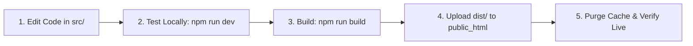

# 🚀 Casa Maria — Hostinger Production Deployment & Maintenance Guide

This guide details everything you need to know about deploying, configuring, and updating **Casa Maria Beachfront Villa** on **Hostinger Single Web Hosting**.

---

## 📑 Table of Contents
1. [Architecture & Hosting Overview](#-1-architecture--hosting-overview)
2. [Upload Routes & Directory Mapping](#-2-upload-routes--directory-mapping)
3. [Pre-Deployment Checklist](#-3-pre-deployment-checklist)
4. [First-Time Deployment (Step-by-Step)](#-4-first-time-deployment-step-by-step)
5. [Production Update & Maintenance Workflow](#-5-production-update--maintenance-workflow)
6. [Quick Updates vs. Full Deployments](#-6-quick-updates-vs-full-deployments)
7. [Hostinger LiteSpeed & Browser Cache Management](#-7-hostinger-litespeed--browser-cache-management)
8. [Troubleshooting Guide](#-8-troubleshooting-guide)

---

## 🏗 1. Architecture & Hosting Overview

- **Frontend Stack**: React 18, Vite 5, Tailwind CSS, Lucide React.
- **Backend / Server Model**: Static Single Page Application (SPA).
  - *No live Node.js background daemon, PM2, or external server process is required on Hostinger.*
  - The site compiles into optimized HTML, minified JS, bundled CSS, and static assets.
- **Hostinger Plan**: **Single Web Hosting**.
  - **Web Server**: LiteSpeed Web Server (fully compatible with `.htaccess`).
  - **Root Directory**: `/home/uXXXXXXX/domains/yourdomain.com/public_html/` (or simply `public_html/` in Hostinger File Manager).
  - **Domain & SSL**: Includes free Let's Encrypt / Hostinger SSL.

---

## 🗺 2. Upload Routes & Directory Mapping

When deploying to Hostinger, **never upload the whole `Casamaria` project folder**. You only deploy the compiled contents of the **`dist/`** directory.

### Exact Mapping Table

| Local Path (Your Computer) | Target Hostinger Path (`public_html`) | Description |
| :--- | :--- | :--- |
| `C:\xampp\htdocs\Casamaria\dist\index.html` | `/public_html/index.html` | Primary entry point of the web app |
| `C:\xampp\htdocs\Casamaria\dist\.htaccess` | `/public_html/.htaccess` | Directs routing, enforces HTTPS, sets caching headers |
| `C:\xampp\htdocs\Casamaria\dist\favicon.ico` | `/public_html/favicon.ico` | Browser tab icon |
| `C:\xampp\htdocs\Casamaria\dist\favicon.jpg` | `/public_html/favicon.jpg` | High-res icon / fallback |
| `C:\xampp\htdocs\Casamaria\dist\assets\` *(folder)* | `/public_html/assets/` | Bundled JavaScript (`.js`) and CSS (`.css`) |
| `C:\xampp\htdocs\Casamaria\dist\img\` *(folder)* | `/public_html/img/` | Villa photography & media assets |

### 🚫 Files / Folders That Must NOT Be Uploaded to Hostinger

- ❌ `node_modules/` (Heavy developer dependencies; never needed in production)
- ❌ `src/` (Source JSX/CSS; already compiled into `dist/assets/`)
- ❌ `package.json`, `package-lock.json`
- ❌ `vite.config.js`, `tailwind.config.js`, `postcss.config.js`
- ❌ `.git/`

---

## ✅ 3. Pre-Deployment Checklist

Before uploading to production, verify each of the following items:

- [ ] **Contact Info Updated**:
  - Open `src/data/villaData.js` and verify real telephone, WhatsApp numbers, email addresses, and address details.
- [ ] **Favicon & Meta Tags**:
  - Check `index.html` title tag, description, and preview metadata.
- [ ] **Domain Nameservers**:
  - In Hostinger hPanel, confirm your domain status is **Active** and points to Hostinger nameservers (e.g., `ns1.dns-parking.com` and `ns2.dns-parking.com` or custom Hostinger DNS).
- [ ] **SSL Certificate Installed**:
  - In hPanel under **Security > SSL**, verify that the free SSL certificate is **Active** for `yourdomain.com` and `www.yourdomain.com`.
- [ ] **Production Build Passes Locally**:
  - Run `npm run build` in PowerShell and ensure there are 0 errors.

---

## 📦 4. First-Time Deployment (Step-by-Step)

### Method A: Hostinger File Manager via ZIP (Recommended — Fastest & Easiest)

#### Step 1: One-Click Build & Package
Run the following in your terminal:
```powershell
cd C:\xampp\htdocs\Casamaria
npm run package
```
*(This automatically builds the production app and generates a ready-to-upload `deploy.zip` in your root folder, including `.htaccess` and all asset bundles).*

#### Step 2: (Alternative Manual Zip)
If you prefer doing it manually without the script:
1. Run `npm run build`.
2. Open [`C:\xampp\htdocs\Casamaria\dist`](file:///C:/xampp/htdocs/Casamaria/dist).
3. Select all contents (`index.html`, `.htaccess`, `favicon.ico`, `favicon.jpg`, `assets/`, `img/`), right-click ➔ **Compress to ZIP file** (name it `deploy.zip`).

#### Step 3: Upload and Extract in Hostinger hPanel
1. Log in to [Hostinger hPanel](https://hpanel.hostinger.com).
2. Go to **Websites** ➔ click **Manage** next to your domain.
3. In the left sidebar or dashboard, click **File Manager** (Access files of your domain).
4. Double-click to open the **`public_html`** folder.
5. If there is a default placeholder file (such as `default.php`), select it and delete it.
6. Click the **Upload** icon (top right) ➔ select **File** ➔ choose `deploy.zip`.
7. Once uploaded, right-click `deploy.zip` in File Manager ➔ click **Extract**.
8. Set the extraction destination to `./` (current directory: `public_html`).
9. After extraction, delete `deploy.zip` to keep your storage clean.

#### Step 4: Verify Deployment
Visit your domain in an incognito window:
```
https://yourdomain.com
```

---

### Method B: Using FTP (FileZilla)

If you prefer using an FTP client like FileZilla:

1. In Hostinger hPanel, navigate to **Advanced ➔ FTP Accounts**.
2. Note your **FTP Host**, **FTP Username**, **FTP Password**, and **Port** (usually `21`).
3. Open FileZilla, enter credentials, and click **Quickconnect**.
4. In the **Remote Site** panel (right), open `/public_html/`.
5. In the **Local Site** panel (left), open `C:\xampp\htdocs\Casamaria\dist\`.
6. Select everything inside `dist\` and drag-and-drop into `/public_html/`.

---

## 🔄 5. Production Update & Maintenance Workflow

Whenever you edit website content, images, layout, or prices in the future, follow this standard production lifecycle:



### Detailed Steps for Future Updates

#### 1. Make Changes Locally
Edit files in `src/` (such as `src/data/villaData.js` for copy/rates, or `src/components/` for layouts).

#### 2. Test Locally
Run the Vite development server to verify your changes:
```powershell
npm run dev
```
Check `http://localhost:5173/` in your browser.

#### 3. Compile the Production Build
Once your changes look good, build the updated bundle:
```powershell
npm run build
```
Vite automatically applies **cache-busting hashes** to the filenames (e.g. `dist/assets/index-XXXXXX.js` and `dist/assets/index-XXXXXX.css`). This guarantees returning visitors will immediately download your new code without being stuck on old cached versions.

#### 4. Upload the Updated Files to Hostinger
Open Hostinger File Manager (or FTP) and replace the files in `public_html/`.

---

## ⚡ 6. Quick Updates vs. Full Deployments

You don't always have to re-upload the entire 50MB image library on every update:

### Scenario A: You only changed text, styling, or code (Fastest: ~10 seconds)
You only need to upload:
1. `dist/index.html`
2. `dist/assets/` *(the new .js and .css files)*

*You do not need to re-upload `dist/img/` if no images were modified.*

### Scenario B: You added or replaced photos in `public/img/` or `img/`
1. Re-run `npm run build`.
2. Upload `dist/index.html`, `dist/assets/`, and the newly added images in `dist/img/`.

### Scenario C: Major release or redesign
Zip the entire `dist/` folder and extract into `public_html/` (replacing existing files).

---

## 🧹 7. Hostinger LiteSpeed & Browser Cache Management

Because Hostinger uses high-performance LiteSpeed caching, updates might sometimes take a few minutes to appear on all devices. To see changes immediately:

1. **Purge LiteSpeed Cache in Hostinger**:
   - In hPanel, go to **Websites ➔ Manage ➔ Performance ➔ LiteSpeed**.
   - Click **Flush All** (Purge Cache).
2. **Bypass Browser Cache Locally**:
   - Press `Ctrl + Shift + R` (Windows) or `Cmd + Shift + R` (Mac).
   - Or test in an Incognito / Private window.

---

## 🛠 8. Troubleshooting Guide

| Issue | Root Cause | Solution |
| :--- | :--- | :--- |
| **"404 Not Found" when refreshing a page or navigating** | Missing or incorrectly configured `.htaccess` | Ensure `.htaccess` exists in `public_html/` with the rewrite rule pointing to `index.html`. *(Included automatically in our build)* |
| **Old version still showing after uploading** | Browser or LiteSpeed server cache | 1. Purge cache in hPanel (Performance ➔ Flush All).<br>2. Force reload with `Ctrl + F5`. |
| **Broken images / 404 on photos** | Images were uploaded to wrong path | Ensure images reside in `public_html/img/` and not nested inside `public_html/dist/img/`. |
| **White blank screen on website** | Base path mismatch | Our `vite.config.js` is configured with `base: './'`. Run `npm run build` to ensure assets load relatively. |
| **"Not Secure" warning in browser** | SSL not enforced | The included `.htaccess` automatically redirects all `http://` traffic to `https://`. Also verify SSL status in hPanel. |
| **Changes not compiling into `dist`** | Forgot to run build command | Always run `npm run build` in PowerShell before uploading. Editing `src/` does not automatically update `dist/` until you build. |
