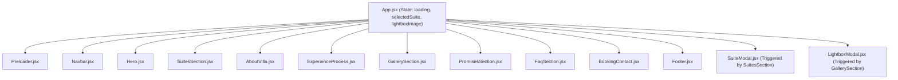

# 🧠 Casa Maria Beach Villa — System Memory & Technical Documentation

> **File:** `system_memory.md` / `system memory.md`  
> **Last Verified:** Current System State  
> **Environment:** Windows (PowerShell) / Node.js v24+ / XAMPP Apache  
> **Project Directory:** `C:\xampp\htdocs\Casamaria`  
> **Production Target:** Hostinger Single Web Hosting (`casamariaph.com`) & Vercel  
> **Local URLs:**  
> - Vite Live Dev: `http://localhost:5173/`  
> - XAMPP Apache: `http://localhost/Casamaria/` (redirects to `dist/`)

---

## 📌 1. System Overview & Core Identity

**Casa Maria Beach Villa** is a high-performance, mobile-responsive luxury web application built for an intimate private beach villa and staycation sanctuary located at **Amunitan, Gonzaga, Cagayan, Philippines**.

The application serves as both the digital branding portal and the primary guest inquiry/booking channel for the property, featuring architectural storytelling, curated accommodation showcases, an interactive gallery with full-screen lightbox viewing, comprehensive stay FAQs, and multi-channel concierge booking options (WhatsApp, Direct Mobile, Email, and interactive Form).

---

## 🏗️ 2. Technology Stack & Architectural Configuration

| Layer | Technology | Details / Notes |
| :--- | :--- | :--- |
| **Framework** | **React 18** (`react`, `react-dom` v18.3.1) | Component-driven architecture using functional components and hooks (`useState`, `useEffect`). |
| **Build Tool & Bundler** | **Vite 5** (`vite` v5.4.6, `@vitejs/plugin-react` v4.3.1) | Fast HMR dev server. Configured with `base: './'` to support both root domains and subdirectory hosting (e.g., `/Casamaria/dist/`). |
| **Styling Engine** | **Tailwind CSS 3.4** (`tailwindcss`, `postcss`, `autoprefixer`) | Custom design system configured with bespoke color palettes, luxury border radii, and glassmorphic shadows. |
| **Typography** | Google Fonts | **Cormorant Garamond** (display/editorial serif) + **Manrope** (clean, modern sans-serif). |
| **Iconography** | **Lucide React** (`lucide-react` v1.16.0) + Custom SVGs | Clean vector icons for amenities, navigation, and custom SVG paths for Facebook and Instagram. |
| **Web Server / Routing** | **Apache / LiteSpeed** (`.htaccess`, `index.php`) | Root `index.php` forwards local Apache requests to `dist/`. The `.htaccess` file manages SPA rewrite rules, HTTPS enforcement, and LiteSpeed browser caching. |

---

## 🎨 3. Design System & Theme Tokens

The design follows a luxury coastal palette defined in [`tailwind.config.js`](file:///C:/xampp/htdocs/Casamaria/tailwind.config.js):

- **Brand Cream (`#F7F5F2`)**: Primary warm background tone.
- **Brand Sand (`#D7C7AE`)**: Warm coastal accent and border tone.
- **Brand Dark Olive / Forest (`#2F3A33`)**: Primary typography and high-contrast element tone.
- **Brand Darker (`#1B241E`)**: Deep hero and footer background tone.
- **Brand Green / Sage (`#586B5A`)**: Secondary accent, highlight pills, active states.
- **Brand Gold (`#C5A880`)**: Number badges, luxury stars, highlight numerals.

---

## 🧩 4. System Functions & Component Architecture

All UI components reside in [`src/components/`](file:///C:/xampp/htdocs/Casamaria/src/components) and are orchestrated by [`src/App.jsx`](file:///C:/xampp/htdocs/Casamaria/src/App.jsx).



### Component Breakdown & Functional Inventory

#### 1. `Preloader.jsx`
- **Purpose**: Creates an elegant branded loading experience on first page entry.
- **Functionality**:
  - Displays circular emblem logo, title, and animated progress indicator.
  - Automatically transitions out after a 1200ms timer with a 600ms CSS fade-out transition.
  - Fires `onComplete()` to unmount from the DOM.

#### 2. `Navbar.jsx`
- **Purpose**: Global sticky navigation and brand header.
- **Functionality**:
  - **Scroll Listener**: Tracks `window.scrollY > 40`. Switches smoothly between transparent gradient overlay (at hero top) and frosted glass header (`bg-[#F7F5F2]/95 backdrop-blur-md` with drop shadow).
  - **Brand Identification**: Displays Casa Maria circular emblem, serif title, and subtitle.
  - **Anchor Navigation**: Smooth scrolls to `#pocetna`, `#suites`, `#o-nama`, `#proces`, `#galerija`, `#faq`, `#kontakt`.
  - **Responsive Mobile Drawer**: Toggles slide-out menu with `Menu` and `X` icons on small viewports.
  - **CTA Button**: Direct "Contact Us" trigger linking to the inquiry section.

#### 3. `Hero.jsx`
- **Purpose**: Full-viewport visual introduction and brand statement.
- **Functionality**:
  - Full-bleed background photography (`villa-panoramic-pool-living.jpg`) with multi-directional gradients for optimal text contrast.
  - Eyebrow badge identifying exact location: *Exclusive Beach Villa • Gonzaga, Cagayan*.
  - Large display serif typography (`text-5xl` to `text-8xl/100px`).
  - Action buttons: "Explore Spaces" (links to `#suites`) and "Contact Us" (links to `#kontakt`).
  - 3-column quick feature highlight strip anchored at the bottom of the hero fold.

#### 4. `SuitesSection.jsx`
- **Purpose**: Showcases the 6 principal rooms, accommodations, and spaces.
- **Functionality**:
  - 6-card responsive grid (`grid-cols-1 md:grid-cols-2 lg:grid-cols-3`).
  - Image cards with zoom-on-hover effect, custom tag pill, room number indicator, and guest capacity.
  - Interactive selection: Clicking any card triggers `onSelectSuite(suite)`, passing the suite object to `App.jsx` to launch `SuiteModal`.
  - **Client Rule**: Price/rates and sqm floor measurements have been removed from the cards per client instructions in `modification-features-bugs.md`.

#### 5. `SuiteModal.jsx`
- **Purpose**: Comprehensive pop-up inspection modal for an individual suite or space.
- **Functionality**:
  - Accessible dialog with backdrop blur, close button, and keyboard `Escape` dismissal listener.
  - Large banner image with subtle gradient overlay.
  - Room specs overview (Capacity, Inquiries & Rates: "Direct Inquiry").
  - 7-point suite inclusion & amenity checklist (marble bathroom, private terrace, fiber Wi-Fi, illuminated pool access, housekeeping, etc.).
  - Action footer with "Close" button and direct "Inquire About This Space" link to `#kontakt`.

#### 6. `AboutVilla.jsx`
- **Purpose**: Brand storytelling and architectural background.
- **Functionality**:
  - Left column: Aspect-ratio framed architectural imagery with floating circular emblem badge.
  - Right column: Narrative story, 4-metric quick stats bar (2 Mins to Beach, 8–16 Guest Capacity, 4 Bedrooms (1 Master), 100% Satisfaction).
  - 4 numbered value pillars with Lucide icons (Tranquil Coastal Setting, Uncompromising Privacy, Attentive Hospitality, Culinary & Dining Salon).

#### 7. `ExperienceProcess.jsx`
- **Purpose**: Step-by-step guest journey guide.
- **Functionality**:
  - 3 numbered cards explaining the booking and stay lifecycle:
    1. *Inquire & Connect* (inquiry form, WhatsApp, direct phone)
    2. *Personalized Stay* (caretaker coordination, arrival details)
    3. *Relax & Unwind* (private villa experience)
  - Interactive hover state with animated accent line.

#### 8. `GallerySection.jsx`
- **Purpose**: Curated visual portfolio of the villa.
- **Functionality**:
  - **Category Filter Tabs**: Filters dynamically by `All`, `Pool & Deck`, `Suites`, `Beach`, `Living`, `Outdoor`.
  - **Masonry-style Spans**: Supports `tall` (`row-span-2`) and `wide` (`col-span-2`) layout variations.
  - **Hover Overlay**: Reveals photo title, category, and zoom icon.
  - **Pagination / Expand**: Shows initial 6 images, with an interactive "View More Spaces" / "Show Fewer Spaces" toggle button.
  - **Lightbox Trigger**: Clicking any image calls `onOpenLightbox(image)` to activate `LightboxModal`.

#### 9. `LightboxModal.jsx`
- **Purpose**: Full-screen high-resolution image preview.
- **Functionality**:
  - Darkened backdrop (`bg-black/95`) with smooth fade-in animation.
  - Keyboard `Escape` listener and click-outside dismissal.
  - Image title and category metadata display with top-right close control.

#### 10. `PromisesSection.jsx`
- **Purpose**: Trust and guarantee commitments.
- **Functionality**:
  - 4 guarantee cards: Absolute Exclusivity, Discretion & Security, Artisanal Quality, and Total Flexibility.

#### 11. `FaqSection.jsx`
- **Purpose**: Interactive accordion answering common guest inquiries.
- **Functionality**:
  - Single-item active accordion state (`openIndex`) with smooth animation.
  - Covers capacity (8 to 16 guests across 4 bedrooms, 1 master bedroom), beach proximity (2-minute stroll), direct villa location in Barangay Amunitan (Google Maps Plus Code 83J6+75M), 100% private compound policy, and check-in/out policies (2:00 PM check-in / 12:00 PM check-out).

#### 12. `BookingContact.jsx`
- **Purpose**: Main conversion section featuring contact points and reservation inquiry form.
- **Functionality**:
  - **Direct Channels**:
    - Telephone: `tel:09560193089` (Philippine mobile: `0956 019 3089`)
    - WhatsApp: `https://wa.me/639560193089` direct concierge chat
    - Email: `mailto:reservations@casamariaph.com`
    - Facebook: `https://web.facebook.com/casamariaph`
    - Instagram: `@casamariabeachvilla`
    - Location: `83J6+75M Amunitan, Gonzaga, Cagayan` (with Google Maps URL)
  - **Interactive Inquiry Form**: Client-side validated form fields (Name, Email, Phone, Message) with real-time submission confirmation feedback.

#### 13. `BookingModal.jsx`
- **Purpose**: Secondary dedicated booking dialog with calendar check-in/out pickers and preselected suite binding.

#### 14. `Footer.jsx`
- **Purpose**: Site-wide footer with brand overview, complete navigation links, verified contact details, social links, and smooth scroll-to-top button (`window.scrollTo({ top: 0, behavior: 'smooth' })`).

---

## 🗄️ 5. Data Architecture & Content Schema

All site copy, assets, suites, gallery items, and contact information are centralized in [`src/data/villaData.js`](file:///C:/xampp/htdocs/Casamaria/src/data/villaData.js).

### Data Schema Overview

```javascript
villaContent = {
  villa: {
    brand: { name, subtitle, tagline, location, mapPin, website, phone, googleMapsUrl },
    nav: [ { id, label } ],
    hero: { eyebrow, titleMain, titleSub, description, ctaPrimary, ctaSecondary, image, highlights: [...] },
    suitesSection: { kicker, title, description },
    suites: [
      {
        number,       // e.g. "01"
        title,        // e.g. "The Master Shoreline Suite"
        tag,          // e.g. "High Timber Ceilings • King Bed"
        desc,         // descriptive narrative
        capacity,     // e.g. "2 Guests"
        image         // relative path e.g. "./img/villa-master-bedroom.jpg"
      }
    ],
    about: { kicker, title, description, image, stats: [...], points: [...] },
    process: { kicker, title, description, steps: [...] },
    gallery: { kicker, title, description },
    galleryImages: [
      { id, title, category, span, url } // span: "normal" | "wide" | "tall"
    ],
    promises: { kicker, title, description, items: [...] },
    faq: { kicker, title, description, items: [ { q, a } ] },
    contact: { kicker, title, description, statNumber, statLabel, phone, whatsapp, facebook, instagram, email, location, googleMapsUrl }
  },
  lorem: { ... } // Alternative Latin Lorem Ipsum edition (requested in note.md)
}
```

---

## ⚡ 6. NPM Scripts & Operational Workflows

All operational scripts are managed via [`package.json`](file:///C:/xampp/htdocs/Casamaria/package.json):

| Command | Action | Output / Description |
| :--- | :--- | :--- |
| `npm run dev` | `vite` | Starts local development server at `http://localhost:5173/` with Hot Module Replacement (HMR). |
| `npm run build` | `vite build` | Compiles and optimizes assets into the `dist/` directory (HTML, CSS, minified JS chunks). |
| `npm run preview` | `vite preview` | Locally serves the compiled production build from `dist/` for pre-flight testing. |
| `npm run deploy-prod` | `npm run build && git push dist to production` | Automatically builds production bundle and force-pushes `dist/` contents directly to the GitHub `production` branch for Hostinger Git Deployment. |
| `npm run package` | `npm run build && Compress-Archive` | Compiles production build and creates a ready-to-upload `deploy.zip` containing `dist/*` and `dist/.htaccess`. |

---

## 🌐 7. Deployment & Hosting Strategy

### Method A: Hostinger Single Web Hosting (`casamariaph.com`)

#### 1. Git Auto-Deployment via `production` Branch (Primary & Recommended)
- **Repository**: `Glenn-IT/Casamaria`
- **Hostinger Target Branch**: **`production`** *(never deploy `main` directly to Hostinger, as `main` contains raw uncompiled React source code and Hostinger shared hosting does not run Node.js/Vite builds)*.
- **Root Directory**: `public_html`
- **Automated Update Workflow**:
  ```powershell
  npm run deploy-prod
  ```
  *(This compiles the latest code into `dist/` and force-pushes all production assets, `.htaccess`, and `index.html` to the `production` branch. Hostinger then pulls the new build immediately into `public_html`).*

#### 2. Hostinger File Manager via ZIP (Manual Fallback)
- **Target Folder**: Hostinger `public_html/`.
- **Workflow**:
  1. Run `npm run package` (or `npm run build`).
  2. Upload `deploy.zip` to Hostinger File Manager inside `public_html/`.
  3. Extract contents directly into `public_html/`.
  4. Ensure `.htaccess` is present for LiteSpeed caching and HTTPS rewriting.
- **Reference**: Detailed step-by-step guide in [`HOSTINGER_DEPLOYMENT_GUIDE.md`](file:///C:/xampp/htdocs/Casamaria/HOSTINGER_DEPLOYMENT_GUIDE.md).

### Method B: XAMPP Localhost (Local Testing)
- **Local Path**: `C:\xampp\htdocs\Casamaria/`
- **Access URL**: `http://localhost/Casamaria/`
- **Routing**: `index.php` in root automatically performs a `302/Header Location` redirect to `dist/`.
- **Important Rule**: Whenever JSX, CSS, or data files are edited, run `npm run build` so XAMPP Apache reflects the new changes.

### Method C: Vercel Cloud Deployment
- **Deployment**: Configured with [`vercel.json`](file:///C:/xampp/htdocs/Casamaria/vercel.json) pointing to Vite output.
- **Command**: `npx vercel --prod`.

---

## 📋 8. Client Directives, Business Rules & Modification Log

1. **Suite Rates & Area (`m²`) Removal**:
   - As documented in [`modification-features-bugs.md`](file:///C:/xampp/htdocs/Casamaria/modification-features-bugs.md), specific nightly pricing and square meter values were removed from suite cards and the suite modal in favor of direct concierge inquiry.
2. **Relative Asset Paths**:
   - `vite.config.js` uses `base: './'` so all asset URLs compile to relative paths (`./assets/...`, `./img/...`). This guarantees the app functions seamlessly in subdirectories (like `/Casamaria/dist/`) without 404 asset failures.
3. **SEO & Structured Data**:
   - `index.html` includes complete Schema.org `LodgingBusiness` JSON-LD structured data, Open Graph meta tags, Twitter card tags, and geographic coordinates for Gonzaga, Cagayan (`18.330688, 122.060438`).
4. **Data Isolation**:
   - UI components consume copy directly from `villaData.js`. Never hardcode textual content or contact details inside individual JSX components.
5. **AI Visibility & Generative Engine Optimization (GEO)**:
   - Configured `public/llms.txt` and `public/llms-full.txt` following the LLMs.txt standard for AI agents (ChatGPT, Claude, Perplexity, Gemini).
   - `.htaccess` configured with `Link` header advertising `/llms.txt`, content negotiation for `text/markdown`, and real HTTP 404 status codes for missing assets and unknown paths.
   - `robots.txt` explicitly allows top AI bots and declares Content Signals.
   - `index.html` Schema.org multi-typed `@graph` covers `LodgingBusiness`, `LocalBusiness`, `Organization`, and `FAQPage`.
   - Heading hierarchy strictly enforced (`<h1>` in Hero only, `<h2>` section headers, `<h3>` subheadings).
   - Legal & Privacy modal added to `Footer.jsx`. Complete audit and resolution details in [`AI_VISIBILITY_DOCUMENTATION.md`](file:///C:/xampp/htdocs/Casamaria/AI_VISIBILITY_DOCUMENTATION.md).

---

## 🛠️ 9. Quick Maintenance Cheat Sheet

- **To update phone numbers, emails, or social links**:
  - Edit the `contact` and `brand` objects in [`src/data/villaData.js`](file:///C:/xampp/htdocs/Casamaria/src/data/villaData.js).
- **To add new gallery images**:
  - Place `.jpg` / `.png` files in [`public/img/`](file:///C:/xampp/htdocs/Casamaria/public/img/).
  - Append an entry to `galleryImages` in [`src/data/villaData.js`](file:///C:/xampp/htdocs/Casamaria/src/data/villaData.js).
- **To compile for deployment**:
  - Run `npm run package` in PowerShell. Upload `deploy.zip` to Hostinger's `public_html/`.
